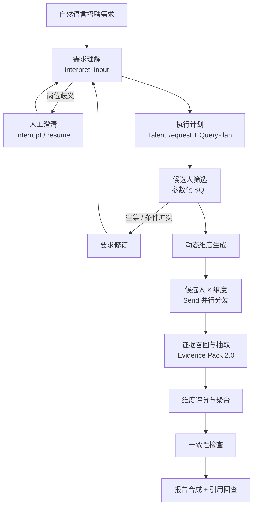

# 多 Agent 人才评估与推荐系统

基于 LangGraph 的多 Agent 系统：用自然语言描述招聘需求，系统自动完成需求理解、候选人筛选、证据召回、多维评估和带引用的评估报告。

[](https://www.python.org/)
[](https://fastapi.tiangolo.com/)
[](https://langchain-ai.github.io/langgraph/)
[](https://react.dev/)
[](https://www.postgresql.org/)
[](https://milvus.io/)

## 解决的问题

HR 和技术面试官评估候选人时，常见三个问题：需求靠口头传递、证据散落在简历 / 述职 / 面评里、结论无法回溯。这个系统把整条链路做成了可执行的 Agent 流程——每一句结论都必须挂回原文片段，材料不足时明确输出“缺失”，而不是让模型编一个分数。

## 功能

| 模块 | 能力 |
|---|---|
| 人才档案 | 员工花名册、资料库、多格式材料上传（PDF / DOCX / PPTX / Markdown / 音频）与异步解析 |
| 材料加工 | MinerU 版面解析、结构化清洗、Parent-Child 分层切分、Milvus 向量索引 |
| 检索 | Query Plan 编译（自然语言 → 受控 Filter DSL → 参数化 SQL）、稠密 + BM25 双路召回、RRF 融合、Rerank 精排 |
| 需求理解 | 区分详细要求与岗位名称，岗位精确 / 模糊匹配、歧义澄清、多轮要求增删改 |
| 评估 | 动态生成评估维度与权重、候选人 × 维度并行分发、要求级并发取证 |
| 报告 | 维度加权聚合、确定性排序、一致性风险检查、Markdown 报告 + 可点击引用 |
| 交互 | SSE 实时事件、节点输出抽屉、Human-in-the-Loop 中断恢复、运行历史回看 |
| 评测 | Case 自动采集、LLM Judge 打分、人工复核 Golden、数据集冻结与模块级重放 |

## 架构



四张 LangGraph 图通过 `backend/langgraph.json` 注册，既可独立运行，也可由决策引擎编排成完整链路：

- `talent_request` — 需求理解、岗位确认、要求修订、计划编译
- `talent_evaluation_dispatch` — 动态维度与并行评估分支
- `talent_evaluation_report` — 评分、聚合、一致性检查、报告渲染
- `talent_decision_engine` — 编排出完整主流程

## 技术栈

| 层 | 选型 |
|---|---|
| API | FastAPI、Pydantic v2、Uvicorn、SSE |
| Agent | LangGraph 1.x、LangChain、`AsyncPostgresSaver` 持久化 Checkpoint |
| 模型 | 通义千问（Chat / Embedding）、可独立配置的 Judge 模型、DashScope OpenAI 兼容端点 |
| 存储 | PostgreSQL 15、Milvus 2.6、MinIO（原始文件）、Redis（队列） |
| 文档解析 | MinerU（版面 / 公式 / 表格）、pypdf、python-docx、python-pptx、faster-whisper |
| 前端 | React 19、TypeScript、Vite、react-markdown |
| 工程 | uv、Docker Compose、pytest、vitest |

## 目录结构

```text
.
├── backend/
│   ├── app/                 FastAPI 应用与 Agent 图
│   │   ├── talent_request_graph.py        需求理解与澄清子图
│   │   ├── talent_evaluation_dispatch.py  维度生成与并行分发
│   │   ├── talent_evaluation_report.py    评分、聚合与报告
│   │   ├── talent_decision_engine.py      链路编排
│   │   ├── talent_tools.py                只读人才工具 + 重试 / 熔断 / 审计
│   │   ├── talent_mcp_server.py           MCP 能力服务（Tools / Resources / Prompts）
│   │   ├── evidence_pack.py               证据协议、来源校验、冲突推导
│   │   ├── hybrid_search_service.py       双路召回、RRF、精排
│   │   └── query_plan.py                  Query Plan 与 Filter DSL
│   ├── scripts/             各链路验收脚本
│   ├── samples/             合成示例数据（岗位、材料、分发结果）
│   ├── tests/               后端测试
│   └── mineru-runtime/      MinerU 解析服务封装
├── frontend/                React 前端（对话、评估中心、运行历史）
├── database/
│   ├── init.sql             完整建表脚本
│   └── migrations/          幂等增量迁移
├── docker-compose.yml       中间件 + 可选应用容器
└── .env.example             环境变量模板
```

## 快速开始

### 前置要求

- Docker / Docker Compose
- Python 3.12 与 [uv](https://docs.astral.sh/uv/)
- Node.js 20+
- 一个可用的模型 API Key（默认走 DashScope）

### 1. 启动中间件

```bash
cp .env.example .env      # 填入 DASHSCOPE_API_KEY 等配置
docker compose -p talent-eval-agents up -d
```

拉起 PostgreSQL（15432）、MinIO（19000 / 19001）、Redis（16379）、Milvus（19531）与 etcd。数据库首次启动会自动执行 `database/init.sql`。

### 2. 启动后端

```bash
cd backend
uv sync --dev
uv run uvicorn app.main:app --reload --host 0.0.0.0 --port 18080
```

### 3. 启动解析 worker

```bash
cd backend
uv run python -m app.worker
```

### 4. 启动前端

```bash
cd frontend
npm install
npm run dev          # http://127.0.0.1:15173
```

### 或者：全部容器化

```bash
docker compose -p talent-eval-agents --profile app up -d --build
```

改代码后用 `up -d --build <service>` 重建；`restart` 不会把新源码带进容器。

### 文档解析服务（可选）

```bash
uv sync --project backend/mineru-runtime
uv run --project backend/mineru-runtime mineru-api --host 127.0.0.1 --port 18001
```

## 核心接口

| 接口 | 用途 |
|---|---|
| `POST /api/documents` | 上传材料，自动创建解析任务 |
| `POST /api/documents/{id}/chunks` | 结构化切分，生成 Parent-Child 关系 |
| `POST /api/evidence/hybrid-search` | 双路召回 + RRF + 精排的证据检索 |
| `POST /api/talent-search` | Query Plan → SQL 候选筛选 → 混合检索，可选返回证据包 |
| `POST /api/runs` | 创建评估 Run |
| `GET /api/runs/{id}/events` | 订阅 SSE 事件流 |
| `POST /api/runs/{id}/resume` | 提交 HITL 选择并恢复执行 |
| `GET /api/runs/history` | 运行历史列表 |
| `POST /api/evaluation/judge` | 批量 LLM Judge 打分 |
| `POST /api/evaluation/replay` | 按模块重放数据集条目 |

完整路由见 `/docs`（FastAPI 自动生成的 OpenAPI 文档）。

## 关键设计

**可信上下文不进模型。** 租户、权限范围、身份、Run 编号通过 `DecisionContext` / `ToolRuntime` 注入，模型只能填业务参数，无法自行生成权限条件或原始 SQL。

**证据门禁。** 模型返回的每条事实都必须引用输入中的 `chunk_id`，且 `quote` 必须是该 Chunk 的连续原文。引用坐标由后端在回表校验后计算，不接受模型生成的位置。校验失败降级为 `partial / extraction_failed` 并保留原始引用，绝不返回未经核验的事实。

**缺失不等于 0 分。** `missing`、`conflicting`、`failed` 的维度分数保持 `null`，聚合时单独统计“可评分覆盖率”，避免把“材料没写”算成“候选人不合格”。

**排名不吃模型。** 聚合按维度权重计算已确认得分，排序依次取已确认得分、可评分覆盖率、候选人编号，全程确定性，模型只负责单维度打分。

**并发受控。** 候选人与维度组成任务矩阵，用 LangGraph `Send` 并行分发；评分默认 12 路并发，一致性检查按候选人并发。实测把外层并发从 3 提到 6 并开启分支内并发后，同规模链路总耗时从 164s 降到 73s。

**可评测。** 每次模块调用自动落库为 Case（输入、实际输出、异常），支持 LLM Judge 打分、人工复核为 Golden、冻结进数据集、再按模块重放。评测不跑整条 Graph，只重放被评估的模块。

## 测试与验收

```bash
cd backend
uv run pytest -q                       # 后端全量
cd ../frontend && npm run test         # 前端
```

各链路的独立验收脚本在 `backend/scripts/`：

```bash
cd backend
uv run --no-sync python -m scripts.verify_talent_decision_graph    # 决策主图
uv run --no-sync python -m scripts.verify_talent_request_graph     # 需求理解与澄清
uv run --no-sync python -m scripts.verify_evidence_pack            # 证据包加工
uv run --no-sync python -m scripts.verify_talent_evaluation_report # 评分与报告
uv run --no-sync python -m scripts.verify_talent_run_live          # 真实链路端到端
```

需要外部模型的测试默认跳过，加 `RUN_LIVE_MODEL_TESTS=1` 才会真正调用模型端点。

## 端口

| 服务 | 端口 |
|---|---|
| PostgreSQL | 15432 |
| Redis | 16379 |
| MinIO API / Console | 19000 / 19001 |
| Milvus gRPC / Health | 19531 / 19091 |
| MinerU | 18001 |
| Backend | 18080 |
| Frontend | 15173 |

## 说明

- 仓库内的 `backend/samples/` 与评测数据集均为虚构材料，不对应任何真实人员，仅用于演示与回归。
- 个人项目，未接入统一认证与多租户计费；租户与权限模型用于演示数据隔离边界。
- `.env` 与所有密钥均不纳入版本控制，请按 `.env.example` 自行配置。
